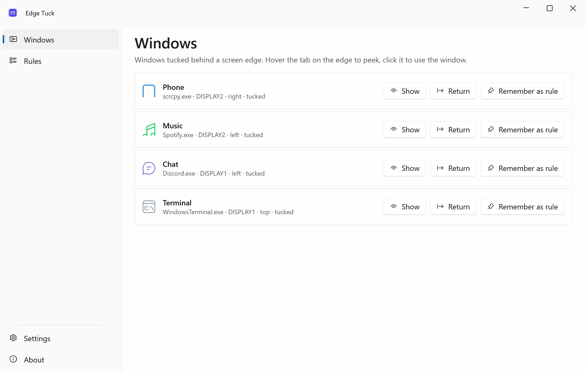
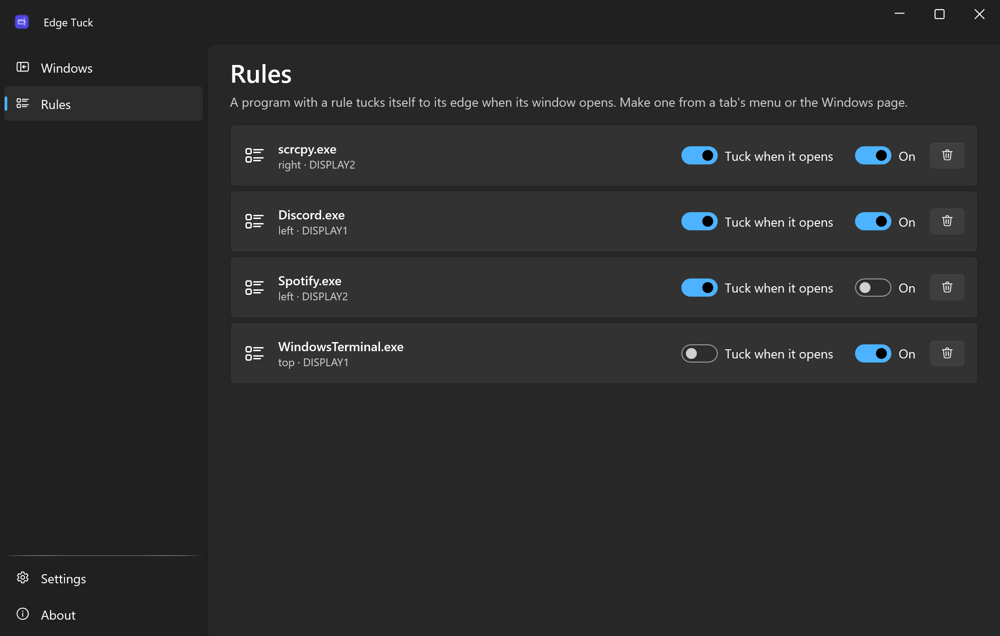
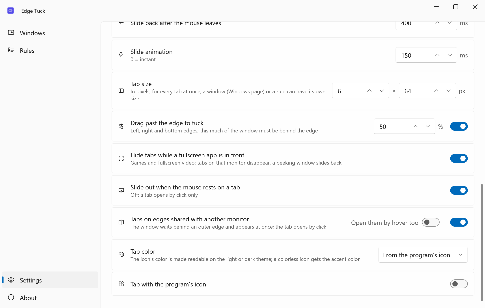
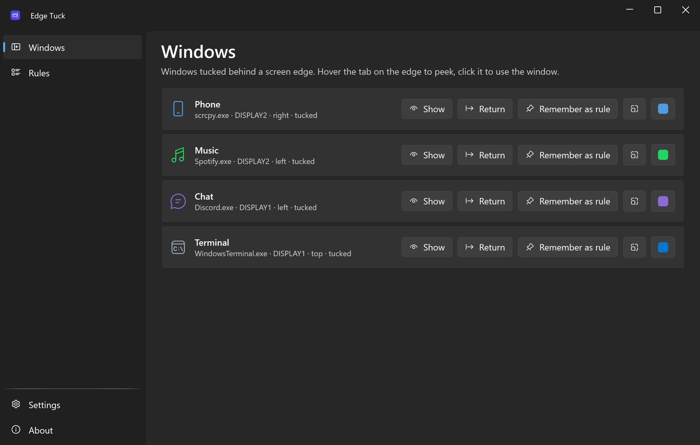
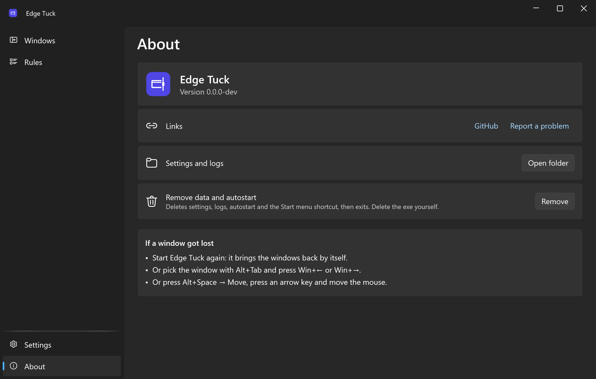

<div align="center">


# Edge Tuck

**Tuck any window behind the screen edge — it slides back out when your mouse gets close.**

**English** · [Русский](README.ru.md)

[](https://github.com/lojekq/EdgeTuck/releases/latest)
[](https://github.com/lojekq/EdgeTuck/releases)
[](https://github.com/lojekq/EdgeTuck/actions/workflows/ci.yml)

[](LICENSE)

<picture>
  <source media="(prefers-color-scheme: dark)" srcset="docs/windows-dark-en.png">
  
</picture>
</div>

## Why

A phone mirror, a chat, a music player or a terminal: you need them every few minutes, and the rest of the time they cover your work.
Edge Tuck slides such a window behind the screen edge and leaves a thin tab there. Point at the tab and the window is back; move away and it is gone again.

## Features

- **Hotkey or drag** — `Ctrl+Win+Alt+←/→/↑/↓`, or drag a window past the left, right or bottom edge; a thin tab stays on the edge.
- **Peek and use** — hover the tab to peek, click it to work in the window, move away and it slides back.
- **Rules** — scrcpy, a chat, music or a terminal tuck themselves to their edge when they open.
- **Out of the way in games** — tabs disappear while a fullscreen app is in front.
- **Never loses a window** — a journal written before every move and a guard process bring everything back, even after a crash.
- **Multi-monitor aware** — down to the free part of an edge (a portrait monitor next to an ultrawide) and mixed DPI. No admin, no telemetry, everything local.

## See it in action


## Screenshots

| | |
|---|---|
|  |  |
|  |  |

## How it works

Edge Tuck injects nothing into other programs and never hides their windows. It only moves a window past the outer edge of the screen,
keeps its own small tab next to it and writes a journal before every move. That is why windows come back even after a crash or a power cut.

Edges are counted by parts: on two monitors side by side the shared edge is not used, and on a portrait monitor next to an ultrawide
only the part of its edge below the seam is free. A window that does not fit there is not tucked, and a note says how much room is free.

## Download

1. Get **`EdgeTuck-x.y.z-win-x64.exe`** from [Releases](https://github.com/lojekq/EdgeTuck/releases/latest). Single file, no install, no admin.
2. Smaller build: `EdgeTuck-x.y.z-win-x64-fd.zip` (needs [.NET Desktop Runtime 10](https://dotnet.microsoft.com/download/dotnet/10.0)).
3. Optional check: `gh attestation verify <file> -R lojekq/EdgeTuck` or compare with `SHA256SUMS.txt`.

Requirements: Windows 11 x64. Windows 10 22H2 should work but is not tested.

## First run

Put the exe into a permanent folder first, for example `%LOCALAPPDATA%\Programs\EdgeTuck\`: autostart and the shortcut point to it.
On the first start Windows may show a SmartScreen warning (see FAQ). The app then lives in the tray; turn on **Start with Windows** in Settings.
Try it: click a window and press `Ctrl+Win+Alt+←`, then point at the tab on the left edge.

| Do this | And this happens |
|---|---|
| Hover the tab | The window slides out without taking focus, and slides back 0.4 s after the mouse leaves |
| Click the tab, or click inside the window | It stays out until you switch to another program |
| Alt+Tab or a taskbar click | A tucked window comes out and stays |
| The same shortcut again on a window that is out | Back to normal |
| Right-click the tab | Return the window, or "Always tuck this program here" |

## Settings

| Setting | Default | What it does |
|---|---|---|
| Shortcuts | `Ctrl+Win+Alt+←/→/↑/↓` | Tuck the active window to that edge of its monitor |
| Return all windows | `Ctrl+Win+Alt+Home` | Emergency: every tucked window back on screen (also in the tray menu) |
| Slide out after hovering the tab | 200 ms | |
| Slide back after the mouse leaves | 400 ms | |
| Slide animation | 150 ms | 0 = instant |
| Tab size | 6 × 64 DIP | Grows with the monitor's scale |
| Drag past the edge to tuck | on, 50 % | Left, right and bottom edges; this much of the window must be behind the edge |
| Hide tabs while a fullscreen app is in front | on | Games and fullscreen video |
| Rules | none | "Always tuck this program here", made from a tab's menu |
| Language, theme | Windows | English or Russian, light or dark |
| Start with Windows | off | Rules work while Edge Tuck runs |
| Start menu shortcut | on when the exe is in `%LOCALAPPDATA%\Programs\EdgeTuck\` | |
| Check for updates | on | Once a day asks GitHub about a new release |

Settings, the journal of tucked windows (`tucked.json`) and logs live in `%APPDATA%\EdgeTuck`. The tray menu has **Pause**: it returns every window and turns the gesture and rules off.

## FAQ

<details><summary>A window got lost</summary>

- Start Edge Tuck again: it brings the windows back by itself.
- Or pick the window with Alt+Tab and press `Win+←` or `Win+→`.
- Or press `Alt+Space` → **Move**, press an arrow key and move the mouse.
</details>

<details><summary>Why can't I tuck a window to the edge between my two monitors?</summary>

The mouse crosses that edge every time it goes from one monitor to the other, so a hover tab there would pop windows out all the time.
Edge Tuck uses outer edges only, down to the free part of an edge. A click-only tab on a shared edge is planned for 1.0.
</details>

<details><summary>"The window runs as administrator: Edge Tuck cannot move it"</summary>

Windows does not let a normal program move the windows of a program started as administrator. Edge Tuck checks every move and says so instead of failing silently.
</details>

<details><summary>Windows protected your PC / SmartScreen warning</summary>

The exe is not code-signed yet, so Windows does not know the publisher. Click **More info → Run anyway**.
Every file is built by GitHub Actions from this repository; you can check it with `gh attestation verify` or `SHA256SUMS.txt`.
Smart App Control, if it is on, blocks unsigned files with no way to allow one; the only option is to turn it off.
</details>

<details><summary>My antivirus flags it</summary>

It is a false positive: the app has no installer, no packer and no obfuscation, and it uses no keyboard or mouse hooks. Please report it to your antivirus vendor
and open an issue with the detection name and the SHA256 of the file.
</details>

<details><summary>How do I uninstall?</summary>

Tray → **Return all windows**, then About → **Remove data and autostart**, then delete the exe.
</details>

## Privacy

No telemetry. The only network request is the update check: `GET https://api.github.com/repos/lojekq/EdgeTuck/releases/latest` once a day; turn it off in Settings.
Edge Tuck changes only the position, the order and the minimized/maximized state of other windows. The journal keeps window handles, process ids and program paths on your PC only.
Logs contain no window titles, paths or other personal data.

## Build from source

```powershell
winget install Microsoft.DotNet.SDK.10
git clone https://github.com/lojekq/EdgeTuck
cd EdgeTuck
dotnet run --project src/EdgeTuck
dotnet test
```

## License

MIT © 2026 lojekq
