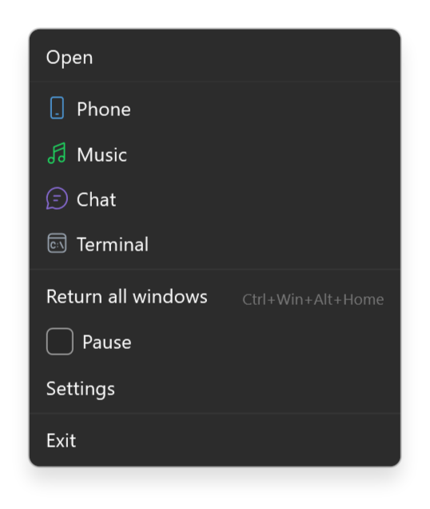

<div align="center">


# Edge Tuck

**Tuck any window behind the screen edge — it slides back out when your mouse gets close.**

**English** · [Русский](README.ru.md)

[](https://github.com/lojekq/EdgeTuck/releases/latest)
[](https://github.com/lojekq/EdgeTuck/releases)
[](https://github.com/lojekq/EdgeTuck/actions/workflows/ci.yml)

[](LICENSE)

<picture>
  <source media="(prefers-color-scheme: dark)" srcset="docs/windows-dark-en.png">
  
</picture>
</div>

## Why

A phone mirror, a chat, a music player or a terminal: you need them every few minutes, and the rest of the time they cover your work.
Edge Tuck slides such a window behind the screen edge and leaves a thin tab there. Point at the tab and the window is back; move away and it is gone again.

## Features

- **Hotkey or drag** — `Ctrl+Win+Alt+←/→/↑/↓`, or drag a window past the left, right or bottom edge; a thin tab stays on the edge.
- **Peek and use** — hover the tab to peek (or click only, if you like), click it to work in the window, move away and it slides back.
- **Rules** — scrcpy, a chat, music or a terminal tuck themselves to their edge when they open; a title filter, a minimum size and a key to show or hide the window (quake mode for any program).
- **Out of the way in games** — tabs disappear while a fullscreen app is in front.
- **Never loses a window** — a journal written before every move and a guard process bring everything back, even after a crash.
- **Tabs that talk** — a tab lights up when its window wants attention; drag a file onto it and the window comes out; drag the tab along the edge, show the program's icon on it.
- **Multi-monitor aware** — down to the free part of an edge (a portrait monitor next to an ultrawide), a click tab even on the edge between two monitors, mixed DPI, virtual desktops. No admin, no telemetry, everything local.

## See it in action

 

## Screenshots

| | |
|---|---|
|  |  |
|  |  |

## How it works

Edge Tuck injects nothing into other programs and never hides their windows. It only moves a window past the outer edge of the screen,
keeps its own small tab next to it and writes a journal before every move. That is why windows come back even after a crash or a power cut.

Edges are counted by parts: on a portrait monitor next to an ultrawide only the part of its edge below the seam is free for a hover tab.
On the part shared with the other monitor the tab opens by click, and the window waits behind an outer edge until then.

## Download

1. **[Download EdgeTuck.exe](https://github.com/lojekq/EdgeTuck/releases/latest/download/EdgeTuck.exe)** (latest release). One file, no admin rights.
2. Smaller build: [`EdgeTuck-fd.zip`](https://github.com/lojekq/EdgeTuck/releases/latest/download/EdgeTuck-fd.zip) (needs [.NET Desktop Runtime 10](https://dotnet.microsoft.com/download/dotnet/10.0)).
3. Optional check: `gh attestation verify <file> -R lojekq/EdgeTuck` or compare with `SHA256SUMS.txt`.

Requirements: Windows 11 x64. Windows 10 22H2 should work but is not tested.

## First run

Run the downloaded exe from anywhere. Windows may show a SmartScreen warning first (see FAQ).
Edge Tuck offers to install itself: **Install** copies it to `%LOCALAPPDATA%\Programs\EdgeTuck\`, adds a Start menu shortcut, autostart and an entry in Settings → Apps; no admin rights.
**Run without installing** keeps it portable. To update, run a newer exe the same way: tucked windows come back on screen, the new version replaces the old one and starts.
Try it: click a window and press `Ctrl+Win+Alt+←`, then point at the tab on the left edge.

| Do this | And this happens |
|---|---|
| Hover the tab | The window slides out without taking focus, and slides back 0.4 s after the mouse leaves |
| Click the tab, or click inside the window | It stays out until you switch to another program |
| Alt+Tab or a taskbar click | A tucked window comes out and stays |
| The same shortcut again on a window that is out | Back to normal |
| Right-click the tab | Return the window, or "Always tuck this program here" |
| Drag the tab along the edge | The window moves along with it |
| Drag a file onto the tab | The window comes out to take it |

## Settings

| Setting | Default | What it does |
|---|---|---|
| Shortcuts | `Ctrl+Win+Alt+←/→/↑/↓` | Tuck the active window to that edge of its monitor |
| Return all windows | `Ctrl+Win+Alt+Home` | Emergency: every tucked window back on screen (also in the tray menu) |
| Slide out after hovering the tab | 200 ms | |
| Slide back after the mouse leaves | 400 ms | |
| Slide animation | 150 ms | 0 = instant |
| Tab size | 6 × 64 DIP | Grows with the monitor's scale |
| Drag past the edge to tuck | on, 50 % | Left, right and bottom edges; this much of the window must be behind the edge |
| Hide tabs while a fullscreen app is in front | on | Games and fullscreen video |
| Slide out when the mouse rests on a tab | on | Off: tabs open by click only |
| Tabs on edges shared with another monitor | on, open by click | The window waits behind an outer edge and appears at once |
| Tab with the program's icon | off | A wider tab with the icon |
| Rules | none | "Always tuck this program here", from a tab's menu or a template (scrcpy, Discord, Spotify, Windows Terminal); title filter, minimum size, own key |
| Language, theme | Windows | English or Russian, light or dark |
| Start with Windows | on after install | Rules work while Edge Tuck runs |
| Start menu shortcut | on after install | |
| Installation | — | Install, or Uninstall when installed |
| Check for updates | on | Once a day asks GitHub about a new release |

Settings, the journal of tucked windows (`tucked.json`) and logs live in `%APPDATA%\EdgeTuck`. The tray menu has **Pause**: it returns every window and turns the gesture and rules off.

## FAQ

<details><summary>A window got lost</summary>

- Start Edge Tuck again: it brings the windows back by itself.
- Or pick the window with Alt+Tab and press `Win+←` or `Win+→`.
- Or press `Alt+Space` → **Move**, press an arrow key and move the mouse.
</details>

<details><summary>What happens on the edge between my two monitors?</summary>

The mouse crosses that edge every time it goes from one monitor to the other, so a tab there opens by click, not by hover (you can change that in Settings).
The window waits behind an outer edge of its monitor and appears at the shared edge at once.
</details>

<details><summary>"The window runs as administrator: Edge Tuck cannot move it"</summary>

Windows does not let a normal program move the windows of a program started as administrator. Edge Tuck checks every move and says so instead of failing silently.
</details>

<details><summary>Windows protected your PC / SmartScreen warning</summary>

The exe is not code-signed yet, so Windows does not know the publisher. Click **More info → Run anyway**.
Every file is built by GitHub Actions from this repository; you can check it with `gh attestation verify` or `SHA256SUMS.txt`.
Smart App Control, if it is on, blocks unsigned files with no way to allow one; the only option is to turn it off.
</details>

<details><summary>My antivirus flags it</summary>

It is a false positive: the app has no packer and no obfuscation, installs only into your user folder and uses no keyboard or mouse hooks. Please report it to your antivirus vendor
and open an issue with the detection name and the SHA256 of the file.
</details>

<details><summary>How do I uninstall?</summary>

Settings → **Uninstall**, or Windows Settings → Apps → Edge Tuck → Uninstall: tucked windows come back on screen first, and you choose whether settings and logs go too.
Without installing: About → **Remove data and autostart**, then delete the exe.
</details>

## Privacy

No telemetry. The only network request is the update check: `GET https://api.github.com/repos/lojekq/EdgeTuck/releases/latest` once a day; turn it off in Settings.
Edge Tuck changes only the position, the order and the minimized/maximized state of other windows. The journal keeps window handles, process ids and program paths on your PC only.
Logs contain no window titles, paths or other personal data.

## Build from source

```powershell
winget install Microsoft.DotNet.SDK.10
git clone https://github.com/lojekq/EdgeTuck
cd EdgeTuck
dotnet run --project src/EdgeTuck
dotnet test
```

## License

MIT © 2026 lojekq
