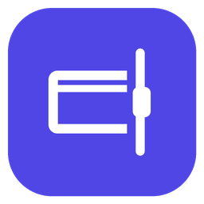
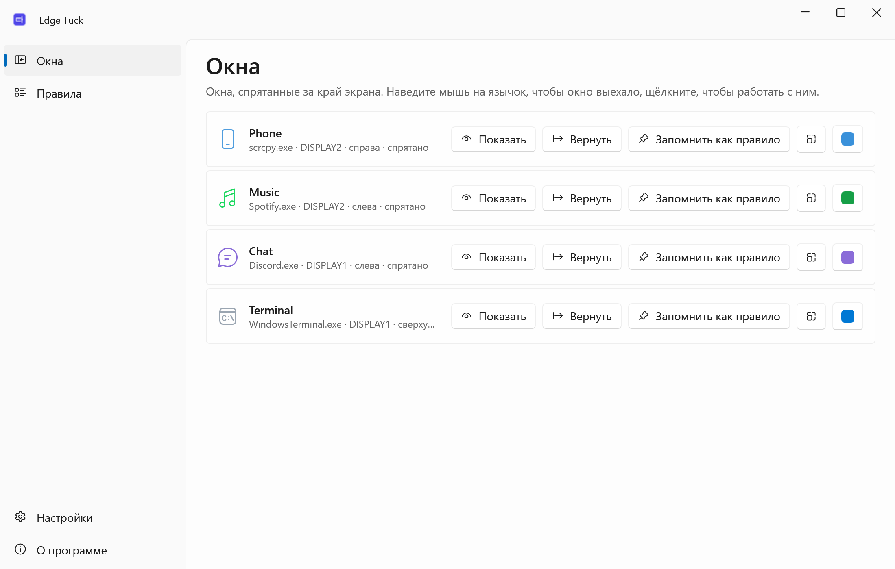
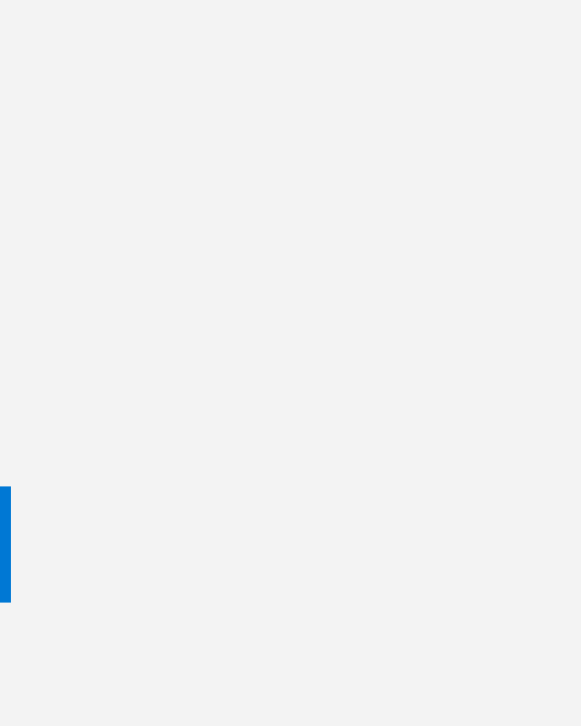
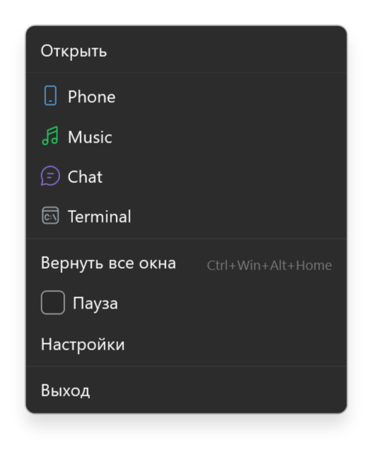
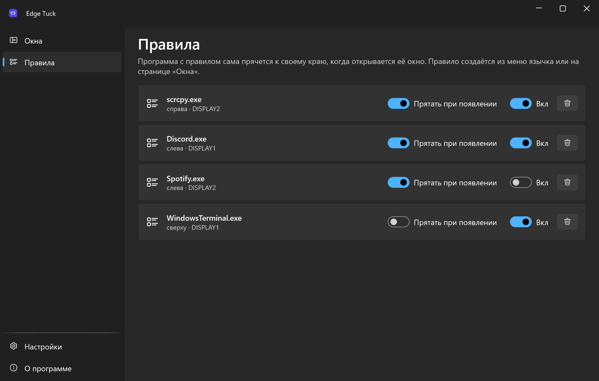
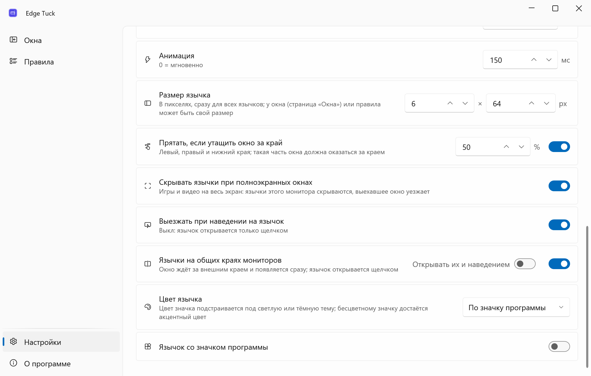
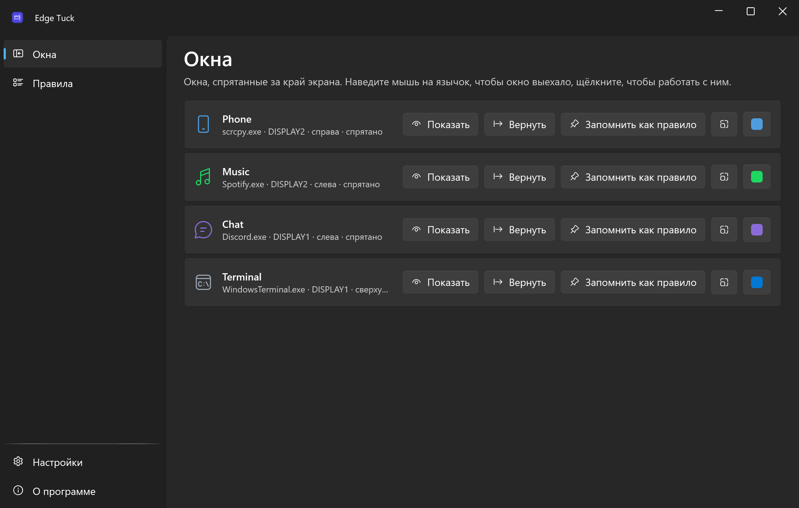
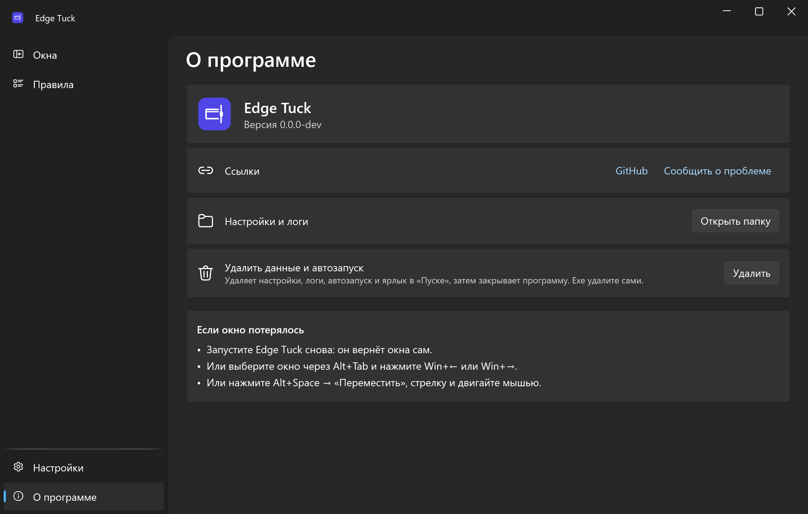

<div align="center">


# Edge Tuck

**Спрячь любое окно за край экрана: оно выедет, как только подведёшь мышь.**

[English](README.md) · **Русский**

[](https://github.com/lojekq/EdgeTuck/releases/latest)
[](https://github.com/lojekq/EdgeTuck/releases)
[](https://github.com/lojekq/EdgeTuck/actions/workflows/ci.yml)

[](LICENSE)

<picture>
  <source media="(prefers-color-scheme: dark)" srcset="docs/windows-dark-ru.png">
  
</picture>
</div>

## Зачем

Зеркало телефона, чат, музыка или терминал нужны раз в несколько минут, а всё остальное время закрывают работу.
Edge Tuck убирает такое окно за край экрана и оставляет там тонкий язычок. Навёл мышь на язычок, и окно на месте; увёл мышь, и окна снова нет.

## Возможности

- **Хоткей или перетаскивание** — `Ctrl+Win+Alt+←/→/↑/↓` или утащить окно за левый, правый или нижний край; на краю остаётся тонкий язычок.
- **Выглянуть и поработать** — навёл мышь, и окно выехало (или только по щелчку, если так удобнее); щёлкнул, и в нём можно работать; увёл мышь, и оно уехало.
- **Правила** — scrcpy, чат, музыка или терминал сами прячутся к своему краю, когда открываются; фильтр по заголовку, минимальный размер и своя клавиша «показать или спрятать» (quake-режим для любой программы).
- **Не мешает в играх** — язычки исчезают, пока впереди полноэкранная программа.
- **Не теряет окна** — журнал пишется до каждого сдвига, а процесс-сторож возвращает всё на место даже после падения.
- **Язычки подсказывают** — язычок окрашен в цвет значка программы (или в ваш цвет), мигает, когда окно просит внимания; перетащите на него файл, и окно выедет; язычок можно двигать вдоль края.
- **Понимает несколько мониторов** — вплоть до свободной части края (портретный монитор рядом с широким), язычок по щелчку даже на крае между мониторами, разный масштаб, виртуальные рабочие столы. Без админа, без телеметрии, всё локально.

## Как это выглядит

 

## Скриншоты

| | |
|---|---|
|  |  |
|  |  |

## Как это работает

Edge Tuck ничего не внедряет в чужие программы и не скрывает их окна. Он только сдвигает окно за внешний край экрана,
держит рядом свой маленький язычок и до каждого сдвига пишет журнал. Поэтому окна возвращаются даже после падения или выключения.

Края считаются по участкам: у портретного монитора рядом с широким для язычка с наведением свободна только часть края ниже шва.
На общей с другим монитором части язычок открывается щелчком, а окно до тех пор ждёт за внешним краем.

## Скачать

1. **[Скачать EdgeTuck.exe](https://github.com/lojekq/EdgeTuck/releases/latest/download/EdgeTuck.exe)** (последний релиз). Один файл, без прав администратора.
2. Версия поменьше: [`EdgeTuck-fd.zip`](https://github.com/lojekq/EdgeTuck/releases/latest/download/EdgeTuck-fd.zip) (нужен [.NET Desktop Runtime 10](https://dotnet.microsoft.com/download/dotnet/10.0)).
3. Проверка по желанию: `gh attestation verify <файл> -R lojekq/EdgeTuck` или сравнение с `SHA256SUMS.txt`.

Требования: Windows 11 x64. Windows 10 22H2 должна работать, но не тестируется.

## Первый запуск

Запустите скачанный exe откуда угодно. Сначала Windows может показать предупреждение SmartScreen (см. «Вопросы»).
Edge Tuck предложит установиться: **«Установить»** копирует его в `%LOCALAPPDATA%\Programs\EdgeTuck\`, добавляет ярлык в «Пуске», автозапуск и запись в «Параметры → Приложения»; права администратора не нужны.
**«Без установки»** оставляет его портативным. Обновление: запустите новый exe так же — спрятанные окна вернутся на экран, новая версия заменит старую и запустится.
Попробуйте: щёлкните окно, нажмите `Ctrl+Win+Alt+←` и наведите мышь на язычок у левого края.

| Что делаете | Что происходит |
|---|---|
| Наводите мышь на язычок | Окно выезжает, не забирая фокус, и уезжает через 0,4 с после ухода мыши |
| Щёлкаете язычок или внутри окна | Окно остаётся снаружи, пока вы не переключитесь в другую программу |
| Alt+Tab или щелчок на панели задач | Спрятанное окно выезжает и остаётся |
| То же сочетание на выехавшем окне | Окно возвращается в обычный режим |
| Правый щелчок по язычку | «Вернуть окно» или «Всегда прятать эту программу сюда» |
| Тащите язычок вдоль края | Окно переезжает вместе с ним |
| Перетаскиваете файл на язычок | Окно выезжает, чтобы его принять |

## Настройки

| Настройка | По умолчанию | Что делает |
|---|---|---|
| Сочетания | `Ctrl+Win+Alt+←/→/↑/↓` | Спрятать активное окно к этому краю его монитора |
| Вернуть все окна | `Ctrl+Win+Alt+Home` | Аварийно: все спрятанные окна на экран (есть и в меню трея) |
| Выезжать после наведения на язычок | 200 мс | |
| Уезжать после ухода мыши | 400 мс | |
| Анимация | 150 мс | 0 = мгновенно; без анимации, если в Windows выключено «Показывать анимацию» |
| Размер язычка | 6 × 64 px | Толщина 2–48, длина 16–600 px, сразу для всех язычков. У правила и у отдельного окна (страница «Окна») может быть свой; язычок со значком не меньше 24 × 48 DIP |
| Прятать, если утащить окно за край | вкл, 50 % | Левый, правый и нижний края; такая часть окна должна оказаться за краем |
| Скрывать язычки при полноэкранных окнах | вкл | Игры и видео на весь экран |
| Выезжать при наведении на язычок | вкл | Выкл: язычки открываются только щелчком |
| Язычки на общих краях мониторов | вкл, по щелчку | Окно ждёт за внешним краем и появляется сразу |
| Язычок со значком программы | выкл | Язычок шире, со значком |
| Цвет язычка | по значку программы | Подстраивается под светлую или тёмную тему (бесцветному значку — акцентный цвет); или акцентный цвет Windows, или свой цвет (палитра или HEX). У правила и у отдельного окна (страница «Окна») может быть свой |
| Правила | нет | «Всегда прятать эту программу сюда», из меню язычка или шаблона (scrcpy, Discord, Spotify, Windows Terminal); фильтр по заголовку, минимальный размер, своя клавиша |
| Язык, тема | как в Windows | Русский или английский, светлая или тёмная |
| Запускать вместе с Windows | вкл после установки | Правила работают, пока запущен Edge Tuck |
| Ярлык в меню «Пуск» | вкл после установки | |
| Установка | — | «Установить», а у установленного — «Удалить» |
| Проверять обновления | вкл | Раз в день спрашивает GitHub о новом релизе |

Настройки, журнал спрятанных окон (`tucked.json`) и логи лежат в `%APPDATA%\EdgeTuck`. В меню трея есть **Пауза**: она возвращает все окна и выключает жест и правила.

## Вопросы

<details><summary>Окно потерялось</summary>

- Запустите Edge Tuck снова: он вернёт окна сам.
- Или выберите окно через Alt+Tab и нажмите `Win+←` или `Win+→`.
- Или нажмите `Alt+Space` → **Переместить**, стрелку и двигайте мышью.
</details>

<details><summary>Что происходит на крае между двумя мониторами?</summary>

Через этот край мышь проходит при каждом переходе с монитора на монитор, поэтому язычок там открывается щелчком, а не наведением (это меняется в настройках).
Окно ждёт за внешним краем своего монитора и появляется у общего края сразу.
</details>

<details><summary>«Окно запущено от администратора: Edge Tuck не может его двигать»</summary>

Windows не даёт обычной программе двигать окна программы, запущенной от администратора. Edge Tuck проверяет каждый сдвиг и говорит об этом, а не молча ничего не делает.
</details>

<details><summary>Windows защитила ваш компьютер / предупреждение SmartScreen</summary>

У exe пока нет цифровой подписи, поэтому Windows не знает издателя. Нажмите **Подробнее → Выполнить в любом случае**.
Каждый файл собран GitHub Actions из этого репозитория; проверить можно через `gh attestation verify` или `SHA256SUMS.txt`.
Если включён Smart App Control, он блокирует неподписанные файлы без возможности разрешить; остаётся только выключить его.
</details>

<details><summary>Антивирус ругается</summary>

Это ложное срабатывание: у программы нет упаковщика и обфускации, ставится она только в папку пользователя и не ставит хуки клавиатуры и мыши. Сообщите об этом производителю антивируса
и откройте issue с названием угрозы и SHA256 файла.
</details>

<details><summary>Как удалить?</summary>

«Настройки» → **«Удалить»** или «Параметры Windows» → «Приложения» → Edge Tuck → «Удалить»: сначала спрятанные окна вернутся на экран, а настройки и логи удаляются по вашему выбору.
Без установки: «О программе» → **«Удалить данные и автозапуск»**, затем удалите exe.
</details>

## Приватность

Телеметрии нет. Единственный сетевой запрос — проверка обновлений: `GET https://api.github.com/repos/lojekq/EdgeTuck/releases/latest` раз в день; выключается в настройках.
Edge Tuck меняет у чужих окон только положение, порядок и состояние «свёрнуто/развёрнуто». Журнал хранит дескрипторы окон, номера процессов и пути программ только на вашем ПК.
В логах нет заголовков окон, путей и других личных данных.

## Сборка из исходников

```powershell
winget install Microsoft.DotNet.SDK.10
git clone https://github.com/lojekq/EdgeTuck
cd EdgeTuck
dotnet run --project src/EdgeTuck
dotnet test
```

## Лицензия

MIT © 2026 lojekq
